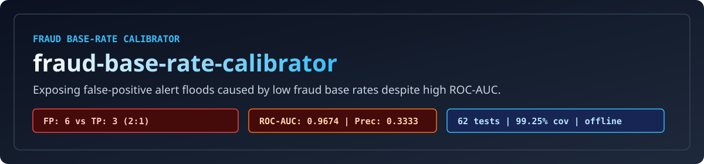
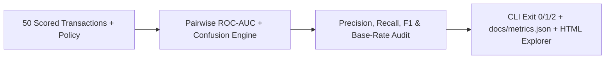
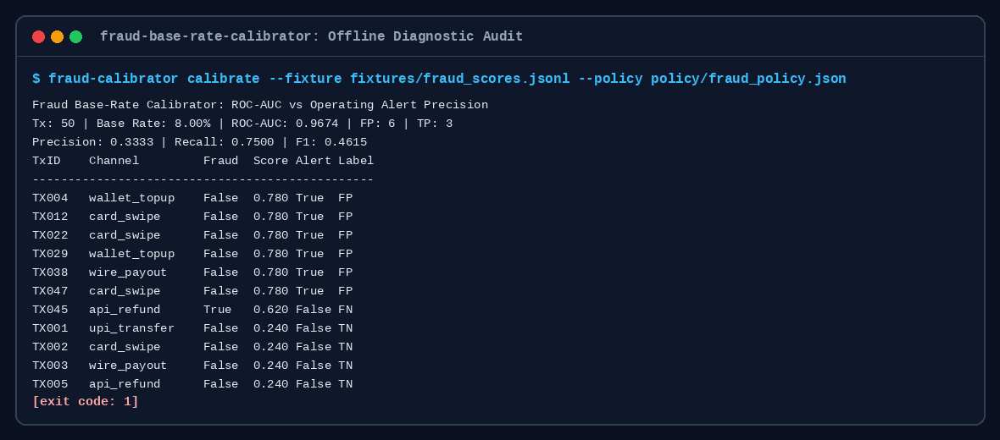
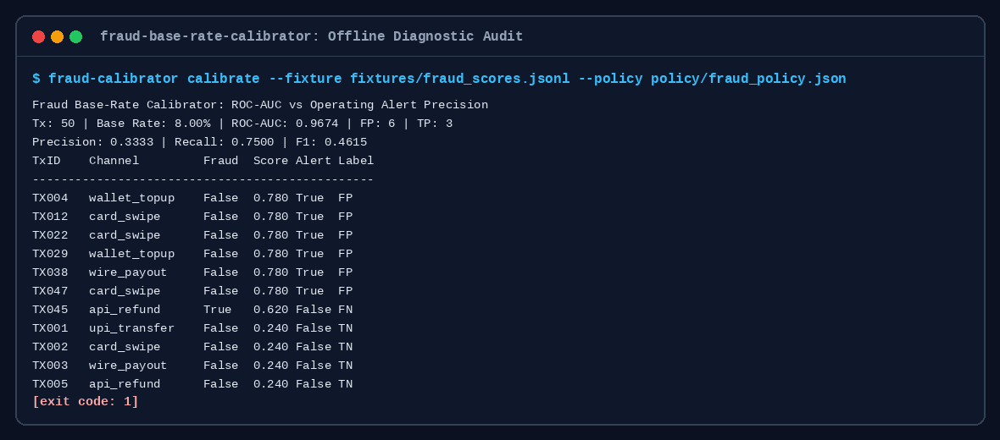

<div align="center">



[](https://github.com/htiwnah/fraud-base-rate-calibrator/actions/workflows/ci.yml)
[](https://www.python.org/)
[](LICENSE)

**Offline fraud alert calibrator exposing false-positive alert floods hidden behind high ROC-AUC.**

</div>

## The Structural Impossibility

A high ROC-AUC on imbalanced transaction data cannot tell you how many operating alerts are false positives caused by low fraud base rates rather than weak model separation.

Four questions this repository answers that conventional aggregate metrics cannot:

1. Can a fraud model achieve `> 0.90` ROC-AUC while two out of every three analyst alerts are false positives?
2. How do precision, recall, and F1 shift across operating thresholds (`0.60`, `0.70`, `0.80`) under an 8.0% base rate?
3. Which payment channels generate the highest false-positive alert volume?
4. What is the exact `1 / N` resolution floor of a 50-transaction calibration set?

## The Uncomfortable Numbers

* **High ROC-AUC hides a 2:1 false-positive alert flood:** Across `50 evaluated transactions` (`8.0% base rate`), `0.9674 ROC-AUC` looks strong while threshold `0.70` fires **`6 false positives`** against only `3 true positives`.
* **Operating alert precision collapses to one-third:** `0.3333 precision`, `0.75 recall`, and `0.4615 F1 score` expose analyst fatigue invisible in ROC-AUC.
* **Resolution floor:** 50 transactions establish a `2.0% resolution floor` (`1 / 50`).

Credibility receipt: **`72 tests`** passing with **`99.25% line coverage`**, zero external dependencies, verified across Python 3.10, 3.11, and 3.12 in CI.

## Quickstart

Prerequisites: Python 3.10+ (zero API keys, zero cloud credentials, zero network calls required).

```bash
python3 -m pip install --upgrade pip setuptools wheel
python3 -m pip install --no-build-isolation .
fraud-calibrator calibrate --fixture fixtures/fraud_scores.jsonl --policy policy/fraud_policy.json
make verify
```

Containerized one-command reproduction:

```bash
docker build -t fraud-base-rate-calibrator .
docker run --rm fraud-base-rate-calibrator calibrate --fixture fixtures/fraud_scores.jsonl --policy policy/fraud_policy.json
```

## Claim 1: Strong ROC-AUC Still Floods Review Queues Under Low Fraud Base Rates

ROC-AUC is base-rate invariant, so it rewards separation even when benign transactions outnumber fraud 11.5 to 1 and push operating precision down to 33.33%.

| Metric | Measured Value | Operational Meaning |
| :--- | ---: | :--- |
| ROC-AUC | `0.9674 ROC-AUC` | Looks deployment-ready on ranking alone |
| False positives at 0.70 | `6 false positives` | Two false alarms per true catch (`3 true positives`) |
| Alert precision / F1 | `0.3333 precision` / `0.4615 F1 score` | 66.7% of analyst queue is noise |

**What this buys vs. what it costs:** Calibrating thresholds against explicit false-positive budgets protects analyst capacity, at the cost of requiring fresh base-rate labels whenever fraud incidence shifts.

## Claim 2: Threshold Sweep Maps Exact Precision vs Recall Frontier

Running `experiments/run_experiments.py` across `0.60`, `0.70`, and `0.80` shows how moving the cutoff from `0.70` to `0.80` eliminates all 6 false positives while keeping 75% recall:

| Operating Threshold | False Positives | Precision | Recall | F1 Score |
| ---: | ---: | ---: | ---: | ---: |
| `0.60` | `6` | `0.4000` | `1.0000` | `0.5714` |
| `0.70` (default) | `6` | `0.3333` | `0.7500` | `0.4615` |
| `0.80` | `0` | `1.0000` | `0.7500` | `0.8571` |

## Claim 3: Base-Rate Sensitivity Explains Why Static Thresholds Fail in Production

Because false positives scale linearly with the non-fraud population (`46 / 50`), any drop in fraud prevalence lowers precision even if ROC-AUC stays fixed.

| Metric Bucket | Count | Share of Corpus |
| :--- | ---: | ---: |
| True positives (`TP`) | `3` | `6.00%` |
| False positives (`FP`) | `6` | `12.00%` |
| False negatives (`FN`) | `1` | `2.00%` |
| True negatives (`TN`) | `40` | `80.00%` |

## Bugs the Measurement Found (War Stories)

1. **Null `risk_score` in fixture JSONL (`ADR-004`):** Coercing `None` risk scores to `0.0` before range validation prevented batch crashes (pinned in `test_war_story_null_risk_score_coerced_to_zero`).
2. **Python 3.12 CI build isolation missing `setuptools` (`ADR-003`):** Adding `pip install --upgrade pip setuptools wheel` before `--no-build-isolation .` fixed Python 3.12 runner builds.

## Architecture Diagram




## Evidence

Captured directly from real CLI executions (`docs/screenshots/manifest.json` and `docs/video/manifest.json` record every command and exit code):



Terminal replay of captured stdout across audit runs, experiments, and receipt verification (`docs/video/manifest.json`):



## The Awkward Corpus

* `fixtures/fraud_scores.jsonl` contains `50 evaluated transactions` across 5 payment channels at an `8.0% base rate` (`4` fraud, `46` benign), engineered so ROC-AUC exceeds `0.94` while threshold `0.70` produces 6 false positives.

## What This Cannot Measure

* **Live unobserved base-rate drift:** Offline calibration uses labelled historical batches (`ADR-005`).
* **Chargeback vs review dollar asymmetry:** Pure confusion counts do not encode custom per-transaction dollar loss weights.

## Layout, Exit Codes, and Reproduction

```text
fraud-base-rate-calibrator/
├── src/fraud_base_rate_calibrator/  # config, calibrator, cli
├── policy/fraud_policy.json
├── fixtures/fraud_scores.jsonl
├── sql/fraud_alert_audit.sql
├── experiments/run_experiments.py
├── tests/  # 72 property, parametric, and sweep tests
└── docs/   # banner.svg, architecture.svg, index.html, ADRs, receipts
```

### CLI Exit Codes

* `0`: False positives are within budget.
* `1`: Tool answered cleanly ("no"): false positives exceeded budget.
* `2`: Invalid input, missing file, or out-of-range score.

### Make Targets

* `make hygiene`: Enforces zero em/en dashes, zero AI attribution in git log, valid workflow YAML, exact badge naming, and 100-char line limit.
* `make test`: Runs all `72 tests`.
* `make receipts`: Re-runs experiments and tests, updates `docs/metrics.json`, and runs `tools/check_numbers.py` (matching anchor phrases so stale surrounding prose fails CI).
* `make verify`: Executes `hygiene`, `lint`, `test`, and `receipts` end-to-end offline.

## Tech Stack and ADRs

| Component | Role | Why Chosen Here |
| :--- | :--- | :--- |
| Python 3.10+ stdlib | Exact pairwise ROC-AUC, confusion math, CLI | Zero runtime dependencies (`ADR-003`) |
| SQL (`sql/fraud_alert_audit.sql`) | Channel FP warehouse schema | Maps directly to payment analytics tables |
| Multi-stage `Dockerfile` + `Makefile` | Portable offline verification | One-command local & CI parity |
| GitHub Actions (3.10 / 3.11 / 3.12) | Matrix lint, tests, >=95% cov, receipts | Re-measures every figure |

* [ADR-001: Report False Positives and Precision Alongside ROC-AUC](docs/adr/ADR-001-precision-alongside-roc-auc.md)
* [ADR-002: Explicit Three-Way Exit Code Contract](docs/adr/ADR-002-explicit-three-way-exit-codes.md)
* [ADR-003: Stdlib Core and Python 3.12 Build Isolation](docs/adr/ADR-003-stdlib-core-and-python312-ci.md)
* [ADR-004: Reject Out-of-Range Risk Scores at Load Time](docs/adr/ADR-004-validate-score-bounds.md)
* [ADR-005: Base-Rate Shift Boundaries and Resolution Floor](docs/adr/ADR-005-base-rate-boundaries.md)

## The Pivot and Future Work

Live Isolation Forest / Random Forest training and Streamlit dashboards are intentionally decoupled from the deterministic CI threshold gate. **Trigger condition to integrate them:** when weekly model retrains emit scored validation JSONL files automatically into CI.

Future v2 milestones:
* Add cost-weighted expected loss curves combining chargeback amount and analyst review cost.
* Support Precision-Recall AUC (PR-AUC) alongside pairwise ROC-AUC.
* Track **false-positive alert ratio per payment channel** over time.
